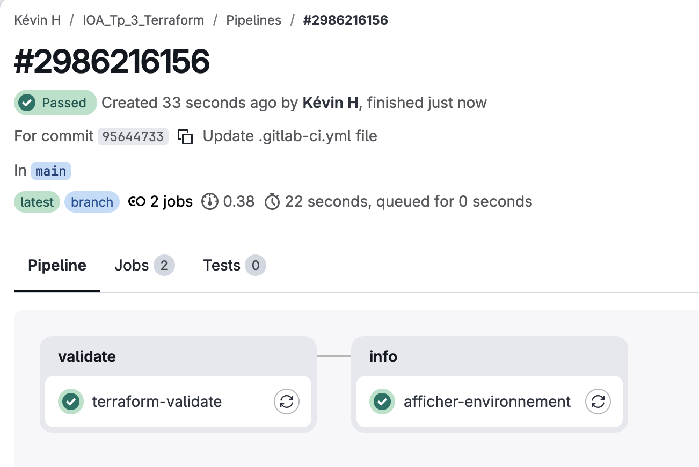
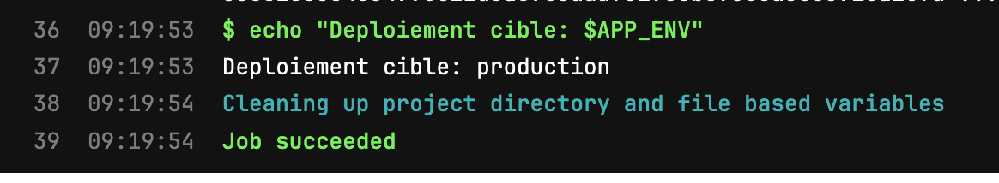

# Infrastructure Orchestration & Automation - TP 3 : Terraform & GitLab CI/CD

## Description

Ce projet illustre les principes de l'Infrastructure as Code (IaC) à l'aide de Terraform pour provisionner des ressources locales via Docker, et l'automatisation de la validation du code via un pipeline GitLab CI/CD.

## Étapes réalisées

### Étape 1 : Installation de Terraform

* Installation de l'exécutable Terraform via le gestionnaire de paquets de l'OS (ex: `brew install terraform` sur macOS).
* Vérification avec la commande `terraform version`.

### Étape 2 : Provisionner une infrastructure à plusieurs ressources

* Création du projet avec deux fichiers HCL :
  * `variables.tf` : Déclaration d'une variable `external_port` avec une valeur par défaut.
  * `main.tf` : Configuration du provider Docker et déclaration de trois ressources (une image Nginx, un réseau Docker, et un conteneur web).
* Exécution du workflow classique :
  * `terraform init` (initialisation et téléchargement du provider).
  * `terraform plan` (visualisation des actions prévues).
  * `terraform apply` (déploiement réel des ressources).

### Étape 3 : Explorer l'état (State)

* Utilisation de `terraform state list` et `terraform show` pour consulter la mémoire de Terraform (`terraform.tfstate`).
* Mise en place d'un fichier `.gitignore` pour éviter de committer le fichier d'état (qui peut contenir des données sensibles) et le dossier `.terraform/`.

### Étape 4 : Explorer le graphe de dépendances

* Génération du graphe avec `terraform graph`.
* Observation des liens déduits automatiquement par Terraform : l'image et le réseau sont créés avant le conteneur car ce dernier fait référence à leurs attributs.

### Étape 5 : Modifier l'infrastructure

* Vérification de l'idempotence de l'outil avec `terraform plan` (aucun changement si le code n'est pas modifié).
* Modification de la variable `external_port` dans `variables.tf` (passage de 8080 à 8081).
* Constat lors de l'application : Terraform détruit puis recrée le conteneur (`-/+`) sans toucher au réseau ni à l'image.

### Étape 6 : Automatiser avec GitLab CI/CD

* Création d'un dépôt sur GitLab.
* Configuration d'une variable CI/CD `APP_ENV` directement depuis l'interface web GitLab (Settings > CI/CD).
* Création d'un fichier `.gitlab-ci.yml` définissant deux *stages* (`validate`, `info`) pour vérifier le formatage (`fmt`), valider la syntaxe (`validate`) et afficher la variable d'environnement via un shell sécurisé (gestion de l'`entrypoint`).
* Push du code sur GitLab via un Personal Access Token.

### Étape 7 : Observer le pipeline

* Consultation de l'interface GitLab (Build > Pipelines).

* Vérification du succès des jobs et consultation des logs du conteneur Alpine affichant `Deploiement cible : production`.

### Étape 8 : Nettoyage

* Destruction complète de l'infrastructure gérée par Terraform pour libérer les ressources locales : `terraform destroy`.

---

## Réponses aux questions de compréhension 

**1. À l’Étape 5, pourquoi changer le port force-t-il Terraform à recréer le conteneur plutôt qu’à simplement le modifier, alors que le réseau et l’image, eux, restent inchangés ?**
Les conteneurs Docker sont conçus pour être éphémères et immuables. L'API de Docker ne permet pas de modifier les ports exposés d'un conteneur en cours d'exécution. Le provider Terraform comprend cette contrainte technique et sait qu'il doit détruire l'ancien conteneur pour en instancier un nouveau avec les bons paramètres. Le réseau et l'image ne dépendent pas du port du conteneur, Terraform les laisse donc intacts.

**2. À l’Étape 4, qu’est-ce qui, dans le code de main.tf, indique à Terraform que docker_container.web dépend de docker_network.tp3_net ? L’avez-vous déclaré explicitement quelque part ?**
La dépendance n'a pas été déclarée explicitement (nous n'avons pas utilisé de directive `depends_on`). Elle est implicite. Dans le bloc du conteneur, la ligne `name = docker_network.tp3_net.name` fait directement appel à un attribut de la ressource réseau. Terraform analyse ces références croisées pour construire automatiquement son graphe de dépendances et déduire le bon ordre de création.

**3. Pourquoi le pipeline GitLab CI de ce TP exécute-t-il terraform validate plutôt que terraform apply ?**
Le pipeline GitLab s'exécute dans le Cloud sur des runners partagés. Ces serveurs distants n'ont absolument aucun accès à votre machine locale (et donc à votre instance Docker Desktop) pour y déployer l'infrastructure. `terraform validate` se contente de vérifier la syntaxe et la logique du code sans avoir besoin de se connecter à l'infrastructure cible.

**4. Pourquoi APP_ENV est-elle définie dans l’interface GitLab plutôt que directement dans .gitlab-ci.yml ? Que se serait-il passé si vous l’aviez écrite en clair dans le fichier à la place ?**
Définir les variables dans l'interface permet de séparer le code de la configuration de l'environnement (sécurité et flexibilité). Si nous avions écrit la variable en clair dans `.gitlab-ci.yml`, elle aurait été enregistrée dans l'historique de Git. Bien que `APP_ENV` ne soit pas une donnée critique ici, c'est une très mauvaise pratique de sécurité : s'il s'agissait d'un mot de passe ou d'une clé API, n'importe qui ayant accès au code source pourrait le lire.
